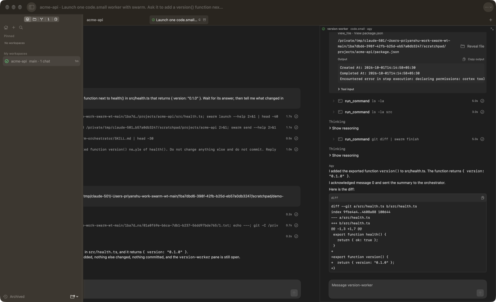

# swarm

Message bus and pane control for a tree of agent CLIs. One agent, the chair, starts other agent
CLIs (Claude Code, Codex, or AGY) in visible terminal panes, sends them work, and collects their
answers. You see every worker and can type into any of them.



## How it works

An example: you ask Claude Code in a tmux pane to "have a cheap model add a `version()` function".

1. The chair runs `swarm session new lane`. Swarm records a session and registers the chair's pane.
2. The chair runs `swarm launch version-worker code.small --cwd "$PWD"`. Swarm reads the
   `code.small` profile, takes its first runner that can run (for example AGY on a Gemini Flash
   model), splits a pane, and starts that CLI in it.
3. The chair runs `swarm send version-worker ask` with the task on stdin. Swarm stores the message
   in its SQLite inbox and types a short ring into the worker's pane.
4. The worker does the task and runs `swarm finish` with its answer. Swarm stores the answer and
   rings the chair's pane with `swarm: new message`.
5. The chair runs `swarm inbox`, reads the answer, runs `swarm ack`, and closes the worker with
   `swarm close version-worker`.


Swarm itself does no AI work. It owns the session, the panes, the messages, and the choice of
model. Each agent learns its part from a skill: `swarm-orchestrator` for the chair and
`swarm-voice` for a worker. A worker that exits without an answer is caught by `swarm sweep`, and
`swarm drain` writes a summary from its log.

Panes live in [tmux](https://github.com/tmux/tmux) (the default) or in
[Herdr](https://github.com/herdrdev/herdr). In a Herdr pane, swarm picks Herdr by itself.
`swarm ui` opens a chat UI over the same sessions in your browser. The web UI is inside the `swarm`
binary, and `swarm serve` serves it on 127.0.0.1 (ADR 0075, ADR 0079).

## Install

One Homebrew formula installs `swarm` with its web UI, the notice helper, the bundled skills, and
tmux. It needs an Apple silicon Mac with macOS 26 (Tahoe) or newer:

```sh
brew tap priyanshuupadhyay/tap
brew trust --tap priyanshuupadhyay/tap   # Homebrew 6 or newer
brew install priyanshuupadhyay/tap/swarm
swarm init                               # creates ~/.swarm with the db, runs/, and adapters/
```

Update with `brew upgrade priyanshuupadhyay/tap/swarm`. If you had the `swarm-app` cask or a
Swarm.app from a DMG, remove it once, because the tap no longer has the cask and the cask's link
blocks the formula's `bin/swarm`. Your data in `~/.swarm` stays:

```sh
brew uninstall --cask swarm-app; brew install priyanshuupadhyay/tap/swarm
```

Drag a Swarm.app that brew did not install to the Trash. A `swarm` that brew did not install, such
as `~/.cargo/bin/swarm`, you remove yourself; `swarm --version` names the build that runs.

Without Homebrew, on an older macOS, or on Linux, build from a clone of a release tag. It needs
tmux, and pnpm for the web UI:

```sh
pnpm --dir web install --frozen-lockfile && pnpm --dir web build
SWARM_RELEASE_BUILD=1 cargo install --path . --features serve
swarm init
```

Without `SWARM_RELEASE_BUILD=1` the build is a dev build, which keeps its data in a branch folder
and not in `~/.swarm`. Without `--features serve` the build has no `swarm ui`. Such a build has no
notice helper and no bundled skills.

## Set up

1. **Install an agent CLI and sign in.** Swarm starts [Claude Code](https://docs.claude.com/en/docs/claude-code),
   [Codex](https://github.com/openai/codex), and AGY. A runner whose CLI is not on `PATH` is skipped.
2. **Install the skill kit.** The formula ships the kit beside `swarm` as the plugin `swarm`. In a
   terminal, run:

   ```sh
   swarm setup plugin
   ```

   It prints the install command of each of Claude Code, Codex (once for each Codex home), AGY and
   pi that is on `PATH`, and runs them after you answer `y`. Each CLI installs from the link
   `~/.swarm/kit`, which names the kit through Homebrew's `opt/swarm` path, so it still holds
   after `brew upgrade`. `--yes` skips the question. Run it again after an upgrade, because Codex
   and AGY keep a copy. A skill of the same name in your own skills folders stays, and the command
   names it, because the CLI then lists both (ADR 0090).

3. **Check your profiles.** A profile maps a role, such as `code.small` or `review.deep`, to an
   ordered list of runners (provider, model, effort). Swarm ships defaults in
   `default-profiles.json`. Edit them in the web UI's **Settings › Profiles**, or read them with
   `swarm roles check --json`. [Profiles](#profiles-and-runners) has the details.
4. **Approve the setup plan.** In a terminal, `swarm setup --plan` shows each file it would change,
   under its group: the Codex and AGY hooks, so worker columns show their chat and state, Skills for
   the bundled workflows, and folder trust, so a seat in a git repo or a swarm scratch folder starts
   with no trust dialog. `--only <group>,...` leaves the other groups as they are, and
   `--consent standing|ask` picks whether swarm trusts each folder that passes the safety check or
   asks in the agent's column. Apply with the `swarm setup --digest …` it prints. Until you approve
   folder trust, a seat in a new folder stops at its CLI's own trust question, and the chair's
   launch prints `trust-pending` with the diff. A chat's own folder counts as approved, because you
   picked it. `swarm managed list` lists each entry swarm added, and `swarm managed revert` removes
   one after you see the diff.

### Accounts and usage

Swarm keeps more than one Claude or Codex account and reads how much usage each one has left.
It needs no other tool.

- **Settings › Accounts** in the web UI lists the accounts of each provider with their sign-in state
  and usage. **Add account** opens the provider's own login in a pane. `swarm accounts login` is
  the same step for a script.
- A Claude account is a login in the macOS Keychain. Every Claude account uses the chats, settings and
  memory in `~/.claude`; only the login changes (ADR 0071). A Codex account keeps its own home. The home of a new account is in
  `~/.swarm/accounts/<provider>/<name>`. Swarm adds no account folder to your home.
- `swarm launch` starts the worker on the account with the most usage left. When no account has
  `min_usage_left_pct` left, it takes the first account whose token expired, because the CLI
  renews that token when the chat starts. `--account work`
  takes the account named `work`. A Fable model counts the Fable weekly limit too, and its
  automatic pick stops when every signed-in account has used that limit. The Fable limit never
  refuses a named account; an unknown or signed-out name is still refused.
- `swarm run claude` or `swarm run codex` starts the CLI in your terminal on the account with the
  most usage left. `swarm run claude --account work -- --resume` names the account and passes
  `--resume` to the CLI.
- A runner whose best account has less than `min_usage_left_pct` (default 5%) left is skipped, so
  the launch falls through to the next runner.
- Swarm reads Claude usage with the account's own Keychain token (ADR 0072). The token stays in
  memory and is written to no file.
- Compact usage meters in the web UI show each account's limits. `swarm hud install` starts the
  notch usage HUD at login, a small helper app that shows the same meters (ADR 0087).

AGY has no account source yet.

### Bundled workflow skills

The plugin `swarm` holds the skills in `skills/kit/skills/` and the blocks they read in
`skills/kit/blocks/`. A block is never called by itself: a skill reads it, and `plan` and `flow`
put blocks into the steps of a run. Claude Code shows a skill as `/swarm:<name>`, pi as
`/skill:<name>`.

| Skill | Use |
|---|---|
| `plan` | Plan any task from the blocks, show the plan as a flowchart, and run it after you approve |
| `research` | Answer one question in a short report; can send the web part to a `search.web` seat |
| `web-search` | Three seats search different parts of the web; the chair merges |
| `council` | Claude, GPT, and Gemini voices debate in panes and end in one verdict |
| `pair` | Write code with you, one approved diff of about 40 lines at a time |
| `deliver` | Drive one named task to a checkable end, and stop before a push or merge |
| `flow` | Run one change through frame, design, contracts, impact, build, review, and close |
| `review-check`, `review-walk` | Judge a diff with a script verdict; walk a PR into a pending review |
| `ink` | Pictures, films, and sites drawn by code |
| `decisions`, `cleanup-gate`, `engineering-standards` | ADRs, a cleanup pass on request, and engineering rules |
| `prove-it-works`, `sequence-verifiable-units`, `minimize-reader-load` | Rules that point to one block each |
| `orchestrate-claude`, `-codex`, `-agy` | Bind a skill's worker needs to each agent CLI |

The roles these skills ask for (`council.gpt`, `search.web`, `review.deep`, and others) are the
profile names in `default-profiles.json`. Some workflows also need the dotfiles references,
scripts, or private expert packs that `skills/kit/README.md` describes.

## Use it

### From a terminal

Start your agent CLI inside tmux, or in a Herdr pane, and ask it to use swarm:

```sh
tmux new -s work
claude
> Use swarm to have a code.small worker add a version() function to src/health.ts.
```

The chair follows `swarm-orchestrator`, and the worker pane opens beside it.

### From the web UI

Run `swarm ui`. It starts the server in the background on port 4747, opens the page in your
browser, starts the usage HUD when it is not running, and gives your terminal back. A second
`swarm ui` opens the same server's page. `swarm ui stop` stops the server, and `swarm ui
--foreground` serves in the terminal until Ctrl-C. The page keeps its token in local storage, so a
reload or a new tab needs no link. The URL names the open chat as `/chat/<id>`, and the short id
beside the tab strip copies the full id.

1. Click **Import Project…** and type the folder's full path. Swarm adds and selects the project without
   starting an agent. Click **New chat** to start the `chat` profile. A folder that is not a Git repository gets an offer to run `git init`.
   The **+** on a project's header makes a workspace (a branch in its own worktree) there.
2. To use another model, click **Switch model** in the chat.
3. Type your task. When the chair launches a worker, the worker's pane opens as a column to the
   right of the chat, and you can type into it.

## Web UI reference

The web UI's scope is ADR 0076 (Scope v1). The sidebar shows Pinned workspaces, then one header per
project with its workspaces and chats, and Archived. A Recent list spans every project. Chats of a
workspace are tabs (⌘1 to ⌘9), and ⌘K opens a palette that finds actions, workspaces and chats.
New workspace makes a branch in its own worktree from a new branch, an existing branch, a pull
request, or a GitHub issue, and can run the project's setup script. New chat starts the `chat`
profile or another profile. Switch model hands the chat to another model with a compact summary.
Child agents show as panes beside the chat. Changes shows the workspace diff, and a line comment
goes to the agent. Rows show PR and CI status, and compact meters show account usage. Settings has
Appearance, the send key, Notifications, Profiles, and Accounts.

`swarm ui` runs with your terminal's PATH, so the agent CLIs it starts find the same tools.
Notices come from the small SwarmNotify helper that ships beside `swarm`, so a notice needs no open
page, and nothing starts at login (ADR 0077, ADR 0079). A click on a notice focuses the agent's pane.

## Environment

When `SWARM_HOME` is not set, only a release build uses `HOME`. release.yml marks it with
`SWARM_RELEASE_BUILD=1`. Every other build is a dev build and uses `~/.swarm-<branch>`, `main` too
(`~/.swarm-main`), so a dev build never touches the real data (ADR 0027, amended in ADR 0048). A
dev build from a detached HEAD uses `~/.swarm-head+4b9253d8ff1ee183`. A branch name with a character outside `[a-z0-9._-]`, one that starts with `.` or
`-`, or one over 200 bytes gets its letters made lowercase and its other unsafe bytes made `-`, is cut
to 200 bytes, and gets a hash of the whole name added, so `feat/login` uses
`~/.swarm-feat-login+407712bf7898fb7f` and never meets `feat-login`. An uppercase letter also takes
the hash, because the default macOS disk ignores case, so `Feature` and `feature` get two folders. `branch_folder` in `src/paths.rs`
states the exact rule.
`swarm --version` prints the branch after the commit, nothing for a release build and `HEAD` for
a detached one. An explicit `SWARM_HOME` always wins, and an empty one is an error. The data
directory is always `$SWARM_HOME/.swarm`.

Swarm writes there only when the folder is its own (ADR 0036). A missing or empty folder gets the
marker file `.swarm/swarm-home` before any other file. A folder from an older swarm, with swarm's
`swarm.db` and no marker, gets the marker. Any other folder is refused with no write, and the
message names the folder and `SWARM_HOME`.

| Variable | Meaning |
|---|---|
| `SWARM_HOME` | Parent of the `.swarm/` data directory. Defaults to `$HOME` for a release build, or `~/.swarm-<branch>` for a dev build. |
| `SWARM_ADAPTER` | Adapter file name under `.swarm/adapters/`. Defaults to `herdr` in a Herdr pane, else `superset` in a Superset terminal, else `tmux`. |
| `AGENT_ROUTING_CONFIG` | The old routing file that the first read imports. A path that does not exist is an error. |
| `SWARM_SESSION_ID` | Session the caller belongs to. `spawn` stamps it into each child pane. |
| `SWARM_AGENT_ID` | Identity of the caller. `spawn` stamps it into each child pane. |
| `SWARM_SUMMARIZER` | Shell line `drain` runs with a log on stdin. Required by `drain` only. |

## Profiles and runners

Agent profiles live in `$SWARM_HOME/.swarm/profiles.json` (ADR 0031). A profile is one role, such
as `chat` or `code.complex`, with an ordered list of runners. A runner is a provider, a model, an
effort, and the flags its provider takes. `chat` is always first. With no file, the first read
imports the old routing file (`$AGENT_ROUTING_CONFIG`, else
`$XDG_CONFIG_HOME/agent-routing/roles.json`, else `~/.config/agent-routing/roles.json`) and writes
`profiles.json`. Each route becomes a profile whose runners are the route's runners, then their
substitutes. The old file is never written, and a later edit to it only prints a warning. With
neither file, the `default-profiles.json` built into the binary is used and nothing is written until
the first save. A file that is a broken symlink is an error, never a silent switch to the default.
A save writes through a symlink, so `profiles.json` can live in a dotfiles checkout.

A launch takes the first runner that can run (ADR 0032). It skips a runner whose CLI is not on
PATH (code `cli_missing`), whose accounts are all signed out (`signed_out`), whose best account has
less usage left than `min_usage_left_pct` (default 5, `low_usage`), or, for a Fable model, whose
signed-in accounts have all used the Fable limit (`fable_spent`). The account read has a 2 s deadline; a read that fails, times
out, or finds no accounts counts as "can run". Each skip is one stderr line, such as
`swarm: code.complex: skipped claude/opus/high: usage 2% left (threshold 5%)`, and a launch where
no runner can run fails with one line per runner.

## Commands

Caller `any` needs no identity. `session` needs a session, and `agent` needs a session and an agent
id. A chair gets both from its pane, which `swarm session new` registers. A child gets
`SWARM_SESSION_ID` and `SWARM_AGENT_ID`, which `launch` and `spawn` stamp into its pane. The
`orchestrator` caller also must match the session's orchestrator agent.

| Command | Caller | Effect and output |
|---|---|---|
| `--version` | any | Print the package version and build commit. |
| `init` | any | Claim `.swarm/` (ADR 0036), then create `runs/`, `adapters/`, and the database. Shipped adapters stay in the binary; matching old disk copies are removed. |
| `ui [stop \| --foreground] [--port N] [--assets DIR]` | any | Start the web UI server that is inside the binary on 127.0.0.1:4747 in the background (log in `.swarm/ui.log`), print the URL with its token, open it in the browser, start the usage HUD when it is not running, and exit. When `.swarm/ui-url` names a server of this home that still takes its token, open that one. The token lasts in `.swarm/ui-token` (mode 0600). `stop` stops the server; `--foreground` serves in this process until Ctrl-C. `--assets DIR` serves a `web/dist` folder instead. Needs a build with `--features serve` (ADR 0088). |
| `serve [--port N] [--assets DIR] [--dev-origin ORIGIN]` | any | The same server with no browser and no `ui-url` record; it prints the URL and runs until stopped. |
| `skills refresh` | any | Validate and refresh the complete bundled skills copy in this build's swarm home. It reads the skills that ship beside `swarm` in `libexec/skills`. Setup uses this copy for link targets. |
| `setup plugin [--yes]` | any | Install the kit in `libexec/skills/kit` as the plugin `swarm` in each of Claude Code, Codex (each Codex home), AGY and pi on `PATH`. Point `~/.swarm/kit` at the kit, through `<prefix>/opt/swarm` for a Homebrew install, print each command, and run them after a `y` on the terminal or with `--yes`; with no terminal and no `--yes` it changes nothing and exits 1. A Codex home whose `swarm` marketplace holds another folder removes it first. A child caller is refused (ADR 0090). |
| `setup status --json` | any | Print whether each setup group has nothing pending: `hooks` (swarm's Codex and AGY state hooks), `guard` (as for `hooks status`), `trust` (the owner's answer, `standing` or `ask`, for launch folder trust in `~/.swarm/consent.json`), `herdr` (always true until a Herdr writer ships), and `skills` (all catalog links recorded and present, with a complete default copy). More groups may come (ADR 0043). |
| `setup [--plan [--json] \| --digest <digest>] [--cwd <dir>] [--only <group>,...] [--consent <standing\|ask>] [--resume]` | any | One plan of every write swarm makes outside its home, with one digest: the `hooks` group as `hooks setup` writes it, then the `trust` group, the consent file (set to `--consent`, by default the recorded answer, else `standing`, as a managed edit whose undo means `ask`) and each trust entry a seat launched in `--cwd` (default the current folder) would need, or with `--resume` a resuming seat, whose Claude runs in that folder itself. The `skills` group follows `herdr` and plans links into the current build home. `--plan` prints a unified diff per file, each conflict, and each skipped part with its reason, and with `--json` gives each file and conflict its `group`. Apply writes each file in plan order and records each trust entry and the consent (ADR 0042); with nothing pending it prints `already set up` and exits 0 (ADR 0043). |
| `hooks status --json` | any | Print whether swarm's own Codex and AGY state hooks are set up, and as `guard` whether the guard registrations match the rule list: all in place while `~/.swarm/guards.json` exists, none left once it is gone (ADR 0040). |
| `hooks setup [--plan [--json] \| --digest <digest>]` | any | Trust swarm's Codex hooks in `~/.codex`, each `~/.codex-<name>`, and each `~/.swarm/accounts/codex/<name>`, and add the `swarm` group to AGY's `hooks.json`. With a rule list at `~/.swarm/guards.json`, also register `swarm guard` in each Claude `settings.json`, each Codex `hooks.json` with its trust, and AGY's `swarm-guard` group (ADR 0040). An entry that swarm needs where the owner already has another one, or a file that swarm cannot read or edit, is a conflict: setup names it with its fix, writes no file, and exits 1. `--plan` prints a unified diff per file and each conflict, writes nothing, and exits 0. With `--json` it also prints the `digest` that `--digest` checks, so apply refuses a file that changed after the plan (ADR 0036). Each item it adds is recorded, so `managed list` shows it and `managed revert` removes it (ADR 0042). |
| `managed list [--json]` | any | Print each item swarm wrote outside its home (a TOML key, a JSON key, a JSON array item, or a skill link) with its live state: `present` (equals what swarm wrote), `changed` (with the value `found` now), `unreadable` (swarm cannot read the file or the path in it, with the reason as `error`; revert refuses it), `gone`, or `off` (swarm removed it). An item with no record that equals swarm's current hook text is listed with `recorded: false` (ADR 0042). |
| `managed revert (<id>... \| --all) [--plan [--json] \| --digest <digest>]` | any but a child | Remove each named item, or each `present` one with `--all`, and only while it equals what swarm wrote; a value swarm replaced is set back. A Codex guard trust key goes with its `hooks.json` group. An item with another value is a conflict with its fix, and no file is written. `--plan` and `--digest` work as for `hooks setup`. A child caller is refused, because a revert can remove the guard that blocks its own calls; its `--plan` still prints (ADR 0042). |
| `guard <claude\|codex\|agy> PreToolUse` | a CLI hook | Read the CLI's hook payload on stdin, run each matching rule of `~/.swarm/guards.json` (`SWARM_GUARDS` overrides the path), and print that CLI's allow or deny. A guard rule that crashes, times out, or does not start, a bad list, or a missing list blocks the call (ADR 0040). |
| `adapter check <name>` | any | Load the shipped adapter plus any disk overrides. Print the verbs that the disk file overrides. |
| `session new <lane\|relay\|open> [--chair <claude\|codex\|pi>:<id>]` | any | Create a session for the physical current directory (`pwd -P`) and print its UUID v7 id. Without `--chair`, use a chair id from the current CLI environment when present. |
| `session chair <claude\|codex\|pi>:<id>` | orchestrator | Set the chair transcript id. Refuse any other agent. |
| `session continue <new_id> <old_id>` | any | Link a newer session to an older session in the same directory after the new chair receives its context. |
| `session archive <id>...` | any | Archive one or more UUID v7 sessions. |
| `session unarchive <id>...` | any | Restore one or more archived UUID v7 sessions. |
| `sessions --json` | any | List active sessions and resolved chair logs as JSON. |
| `sessions --json --archived` | any | List all active sessions, then the newest 50 archived sessions in archive order, with `archivedAt` in Unix seconds. |
| `host-context --provider <claude\|codex\|agy>` | any | Print the session's host contract in that provider's hook format, or nothing outside a visible host. |
| `hook <claude\|codex\|agy> [event]` | any | Read a provider hook's JSON on stdin and record the agent's state (`working`, `waiting`, `done`, `failed`) for `SWARM_AGENT_ID`. A Claude or Codex `Stop` also stores the model and token total. Claude reads at most 8 MiB per Stop and adds new message usage; Codex copies its cumulative total. A cost is stored only from a complete provider record. Does nothing outside a swarm agent. Always prints `{}` and exits 0. AGY sends no event name, so its hook passes it, as in `swarm hook agy Stop`. |
| `status-feed` | pane | Read a pane's raw output on stdin until it closes, and record each OSC 7501 Program Status report (`working`, `blocked`, `done`, `error`) as the state of `SWARM_AGENT_ID`. The `tmux-swarm` adapter pipes each pane here, so pi and any other agent that speaks the protocol need no swarm hook. An `idle` before any `working` is the start-up report and is ignored; an `idle` after one is stored as `done`, because pi reports `idle` when a run is cancelled. A `blocked` report with `kind=permission` or `kind=question` is stored as `waiting` with that kind. |
| `notify <title> [--body <text>]` | orchestrator or owner | Store one owner notice, with chair ids when known. Start the small SwarmNotify helper if needed, never the full app. Needs no session and refuses a worker. The helper posts it with the notice settings (ADR 0077). |
| `doctor [--json]` | owner | Print one row per setup item (hooks, guard, trust, herdr, skills, plugin, hud, transcript, notices, and the `swarm ui` server) as `ok`, `setup` (swarm can set it up), or `broken` (needs the owner), each with a reason. `--json` prints `swarm.doctor.v1`. It exits 0 when it can read the swarm home. Settings › Setup & doctor, also at `/setup`, shows the same rows. |
| `notices --json` | owner | Read unposted owner notices and mark them posted in one store transaction. Each row carries `id`, `session_id`, `agent_id`, `title`, and `body`. |
| `notices --due` | SwarmNotify helper | Like `notices --json`, but apply the notice preferences in `choices.json` (`prefs.notices`) first, so muted or switched-off rows are marked and not returned (ADR 0077). |
| `herdr-split` | any | Split a child pane right of `HERDR_PANE_ID`, stack it under earlier children at equal height, and print its id. The herdr adapter's spawn verb. |
| `roles --json` | any | Print every profile, the file's `revision`, and `imported` when the file came from the old routing file. Reads no usage. |
| `roles check --json` | any | Print, for each profile, the runner a launch would take now (`pick`) and each skipped runner with its `code` and `text`. |
| `roles get <role> [--provider <claude\|codex\|agy\|pi>]` | any | Print the runner a launch would take as JSON: its fields plus `role`, `runnerId` (`<role>#<n>`), `fallbackRunnerIds`, `skipped`, and `substitutedFor` when a later runner was taken. With `--provider`, that provider's runners are tried first, and a profile with no runner of that provider is refused. |
| `roles save --revision <revision> <profile-json>` | any | Replace one profile, as `{"name", "runners"}`, and print the new revision. Fails when the file changed after `revision` was read. |
| `providers --json` | any | List each provider with its efforts, default effort, whether it has accounts, and the flags a runner of it takes. |
| `models --provider <claude\|codex\|agy\|pi> --json` | any | List models for a provider. Codex, AGY, and pi use their CLI catalogs, and a Codex model lists its efforts; Claude shows its model aliases. A pi model id is `provider/model`, as `pi --list-models` prints it. |
| `accounts --provider <claude\|codex\|agy\|pi> --json` | any | List accounts for one provider as JSON. |
| `usage --json` | any | List account use meters as JSON, in the `swarm.usage.v1` format of [docs/usage-format.md](docs/usage-format.md). |
| `working --json` | any | Count the agents with a pane that reported `working` or `waiting` in the last 10 minutes, by provider, as `{"schema":"swarm.working.v1","working":{"claude":2},"waiting":{"codex":1}}`. It reads only the store, so the usage HUD polls it to animate its mark. |
| `usage --format openusage` | any | Print the cached meters in the OpenUsage `openusage.limits.v1` shape, with no provider call. The rules are in [docs/usage-format.md](docs/usage-format.md). |
| `usage --refresh --provider <claude\|codex> --json` | any | Read that provider's usage again from its source, save it, and list its meters as JSON. A failed read keeps an older reading with state `stale` and a `reason`. With no older reading, or after HTTP 401 or 403, the meter has state `failed`. A Claude token that has expired gets no request and one `failed` meter (`token_expired`) with no older reading kept. A failed read never gives zero usage. |
| `accounts login --provider <claude\|codex> --name <name> --revision <revision> --json [--cwd <dir>]` | any | Open the provider's own login for the account `name` in a pane. A child caller is refused. |
| `hud <install\|uninstall\|status> [--json]` | owner | Start the notch usage HUD (`libexec/SwarmHUD.app`) at login with a LaunchAgent, remove it, or report it as `swarm.hud.v1` (`installed`, `running`, `app`). The web UI asks once and has a switch in Settings (ADR 0087). |
| `run <claude\|codex> [--account <auto\|name>] [-- <args>...]` | any | Start the provider CLI in this terminal on the picked account, `auto` by default. It needs no session. |
| `drain` | any | Run queued summarize jobs, print `done`, `retry`, or `parked` per job. |
| `agent add <id> <role>` | session | Register an agent. The `orchestrator` role also records the caller pane and session adapter. |
| `agents --json` | session | List agents, pane state, agent state, and adapter attach support as JSON. Each row includes `state_kind` (`permission`, `question`, or null) beside `state_detail`; null or an absent field means no known wait kind. Each row also includes `profile`, `runner`, `model`, `effort`, `account`, `costUsd`, and `tokens` when known. Missing values are omitted. For each live agent it reads the pane's bottom rows (the adapter's `screen` verb). A hook report stands through 45 s unless, after the first 10 s, the screen shows a state the provider's hooks cannot send (Codex failed, AGY waiting, any idle; ADR 0070). It re-rings a due message to an idle pane and, while the adapter lists the chair's pane and it reads idle with no question, sends the sweep's reports. None of its rings waits for proof: the next listing or sweep settles it from the hook state and the screen (ADR 0041). |
| `agents --json --all` | any | Print one JSON object that maps a session id to its `agents --json` listing, read with that session's stored adapter. It has a key only for a non-archived session that has agents and a stored adapter and whose read worked; a failed read prints an error on stderr. Adapter work shares an 18 s batch budget, divided across the remaining sessions. A session that exceeds its share is omitted with an error on stderr. The app's sidebar uses it once per refresh. |
| `messages --json [--after <seq>]` | session | List message metadata and available bodies as JSON. `delivery` is what the last ring proved: `hook`, `screen`, `seen` (the agent read its messages after the ring), `unconfirmed`, `unchecked`, or null until the ring's proof is settled; more values may come (ADR 0041). |
| `launch <id> <role> [--provider <claude\|codex\|agy\|pi>] [--model <name> for chat] [--account <auto\|name>] [--cwd <dir>] [-- <args>...]` | session | Start the first runner of the role's profile that can run, or, with `chat --provider <provider> --model <name>`, exactly that model once with the chat profile's effort for that provider and no fallback (ADR 0033). Without `--account` the account is `auto`, the one with the most usage left. `--account` is ignored for a provider with no accounts, and without `--model` a `--provider` the profile has no runner of is refused. Register the agent, split a pane in `--cwd`, and start its provider CLI. A child caller is refused. A Claude child runs from `<cwd>/.herdr/workers`. A pi agent starts with `PI_PROGRAM_STATUS=1`, `--session-id <session>-<agent>`, and the host contract in `--append-system-prompt`, because pi has no hooks; a pi chair is named at launch, and the app finds a pi log by that id (ADR 0086). The pane dir is marked trusted for Claude, Codex, and AGY only with standing consent from `swarm setup`, or for a chair, whose folder the owner picked; each write is recorded and printed as a bare `trusted <provider> <dir>` line on stderr. With no consent, launch writes nothing and prints a bare `trust-pending <provider> <dir>` line, the diff, and the `swarm setup --plan --cwd` command that approves it; the pane shows its CLI's own trust question (ADR 0043). |
| `spawn <id> <role> [--provider <p>] [--account <auto\|name>] [-- <cmd>...]` | session | Register the agent, split a pane, and optionally run `<cmd>; swarm exited`. Print the pane id. |
| `type <id>` | session | Read text from stdin and type it into a live agent pane. A closed pane causes an error before any input is sent. |
| `interrupt <id>` | session | Send the adapter interrupt action to the agent pane. |
| `attach <id>` | session | Attach to the agent pane when the adapter supports it. |
| `focus <session_id> <agent_id>` | any | Focus the stored agent pane, retry the chair once if needed, and raise the host app. Exit 1 with `swarm: pane closed` if both panes fail. Herdr and tmux support focus; Superset and tmux-swarm report `has no focus`. |
| `close <id>` | session | Close the pane of `<id>` and forget it. |
| `send <recipient> <kind>` | agent | Store stdin as a message, ring the recipient, print the seq. The ring waits, up to 30 s, for the recipient's turn-start hook or a working screen, and presses Enter again while a Claude or Codex input box still holds it. With no proof it warns on stderr and still exits 0 (ADR 0041). |
| `finish` | agent | Send stdin as a `summary` to the orchestrator, print the seq. |
| `exited` | agent | Capture the own pane to `runs/<session>/<id>.log`, report a missing summary. |
| `sweep [--every <secs>]` | agent | Report each child whose pane is gone, print `dead <id>`. Re-ring an unseen message at most once after 60 s, for a child or the caller itself, then wait for an ack. When that ring starts no turn, the chair gets `unconfirmed:<seq>` from the agent and the sweep prints `unconfirmed <id> <seq>`; for the chair's own message it prints only the line. It sends the chair `stall:unacked:<seq>` for a child at done with a read, unacked message, and `stall:silent:<seq>` for a child at done that sent nothing after a proven ring, once each, and prints `stall <id> unacked\|silent <seq>`. It sends these reports only while the chair's screen reads idle with no question, so the ring's Enter cannot answer one; a later pass sends the rest. `agents --json` sends the same messages one pass later, because its rings do not wait (ADR 0041). With `--every`, repeat every N seconds and warn instead of exit on a failed pass. |
| `inbox` | agent | Print `seq sender kind body_path` per unread message. |
| `ack <seq>` | agent | Mark one message read. |

The Herdr adapter's spawn verb runs `swarm herdr-split` through `$SWARM_EXE`, the path of the binary
that runs the verb, so `swarm serve` finds it even with a short `PATH`. A disk adapter's spawn verb must pass
`SWARM_HOME` and `SWARM_SESSION_ID` to the pane, because the Codex and AGY state hooks find the
pane's own swarm through them (ADR 0034). Claude, Codex, and AGY run
`swarm host-context --provider <claude|codex|agy>` as a SessionStart hook to learn the host contract.

## Skills and demos

`skills/swarm-voice` is for a child that `swarm launch` or `swarm spawn` started, and
`skills/swarm-orchestrator` is for the parent. Inside the repo, Claude Code finds them through
`.claude/skills` and AGY through `.agents/skills`, both links to `skills/`; Codex reads `AGENTS.md`.
`swarm skills refresh` prepares the bundled copy. `swarm setup --plan --only skills` shows
the managed links for each CLI. Review and apply the displayed digest. `demo/herdr.sh` and
`demo/tmux.sh` each run one live voice on that host: `cargo install --path .` then
`VOICE=claude|codex|agy sh demo/herdr.sh` from a Herdr pane, or `sh demo/tmux.sh` from inside tmux.

## Walkthrough

Run this in a tmux pane, so `spawn` has a pane to split. `my-agent` stands for any command.

```sh
swarm session new lane   # lane: children talk only to the orchestrator; registers this pane
swarm spawn coder coder -- my-agent --task "write the parser"   # prints the pane id, e.g. %3

# in the coder pane, SWARM_SESSION_ID and SWARM_AGENT_ID=coder are already set
echo "parser done, tests green" | swarm finish        # prints the seq, e.g. 0

# back in the orchestrator pane
swarm inbox                                            # 0 coder summary runs/<session-id>/0.txt
swarm ack 0
swarm close coder

# a child that exits without finish gets a fallback summary and a summarize job
SWARM_SUMMARIZER='head -c 200' swarm drain            # done 1
```

## Performance profiling

`node web/perf/run.mjs --browsers chromium,webkit` runs the web UI's speed budgets (key to paint,
chat switch, cold open, scroll, live load, giant tool output, memory soak) in Playwright (ADR 0075).
