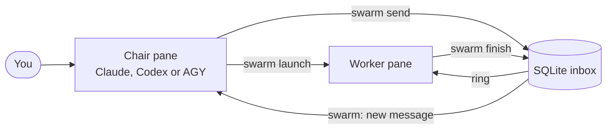

# swarm

Message bus and pane control for a tree of agent CLIs. One agent, the chair, starts other agent
CLIs (Claude Code, Codex, or AGY) in visible terminal panes, sends them work, and collects their
answers. You see every worker and can type into any of them.


## How it works

An example: you ask Claude Code in a tmux pane to "have a cheap model add a `version()` function".

1. The chair runs `swarm session new lane`. Swarm records a session and registers the chair's pane.
2. The chair runs `swarm launch version-worker code.small --cwd "$PWD"`. Swarm reads the
   `code.small` profile, takes its first runner that can run (for example AGY on a Gemini Flash
   model), splits a pane, and starts that CLI in it.
3. The chair runs `swarm send version-worker ask` with the task on stdin. Swarm stores the message
   in its SQLite inbox and types a short ring into the worker's pane.
4. The worker does the task and runs `swarm finish` with its answer. Swarm stores the answer and
   rings the chair's pane with `swarm: new message`.
5. The chair runs `swarm inbox`, reads the answer, runs `swarm ack`, and closes the worker with
   `swarm close version-worker`.



Swarm itself does no AI work. It owns the session, the panes, the messages, and the choice of
model. Each agent learns its part from a skill: `swarm-orchestrator` for the chair and
`swarm-voice` for a worker. A worker that exits without an answer is caught by `swarm sweep`, and
`swarm drain` writes a summary from its log.

Panes live in [tmux](https://github.com/tmux/tmux) (the default) or in
[Herdr](https://github.com/herdrdev/herdr). In a Herdr pane, swarm picks Herdr by itself.
`swarm ui` opens a chat UI over the same sessions in the Swarm app. The web UI is inside the `swarm`
binary, and `swarm serve` serves it on 127.0.0.1 (ADR 0075, ADR 0079).

## Install

One Homebrew formula installs `swarm` with its web UI, the notice helper, the bundled skills, and
tmux. It needs an Apple silicon Mac with macOS 26 (Tahoe) or newer:

```sh
brew tap priyanshuupadhyay/tap
brew trust --tap priyanshuupadhyay/tap   # Homebrew 6 or newer
brew install priyanshuupadhyay/tap/swarm
swarm init                               # creates ~/.swarm with the db, runs/, and adapters/
```

Update with `brew upgrade priyanshuupadhyay/tap/swarm`. If you had the `swarm-app` cask or a
Swarm.app from a DMG, remove it once, because the tap no longer has the cask and the cask's link
blocks the formula's `bin/swarm`. Your data in `~/.swarm` stays:

```sh
brew uninstall --cask swarm-app; brew install priyanshuupadhyay/tap/swarm
```

Drag a Swarm.app that brew did not install to the Trash. A `swarm` that brew did not install, such
as `~/.cargo/bin/swarm`, you remove yourself; `swarm --version` names the build that runs.

Without Homebrew, on an older macOS, or on Linux, build from a clone of a release tag. It needs
tmux, and pnpm for the web UI:

```sh
pnpm --dir web install --frozen-lockfile && pnpm --dir web build
SWARM_RELEASE_BUILD=1 cargo install --path . --features serve
swarm init
```

Without `SWARM_RELEASE_BUILD=1` the build is a dev build, which keeps its data in a branch folder
and not in `~/.swarm`. Without `--features serve` the build has no `swarm ui`. Such a build has no
notice helper and no bundled skills.

## Set up

1. **Install an agent CLI and sign in.** Swarm starts [Claude Code](https://docs.claude.com/en/docs/claude-code),
   [Codex](https://github.com/openai/codex), and AGY. A runner whose CLI is not on `PATH` is skipped.
2. **See what swarm sets up.** In a terminal, run:

   ```sh
   swarm setup
   ```

   It lists each item with its state and writes nothing. `swarm setup all` sets up each item that
   needs it, and `swarm setup <item>,...` sets up only those. Each run shows its plan first, the
   diff of each file and each command, and asks `Apply this plan? [y/N]`. `--yes` skips the
   question, and `--plan` only prints the plan with the `--digest` command that applies it (ADR 0092).
   The items are:

   - `hooks`: the Codex and AGY hooks, so worker columns show their chat and state, and the
     command guard when `~/.swarm/guards.json` exists.
   - `trust`: launch folder trust, so a seat in a git repo or a swarm scratch folder starts with no
     trust dialog. `--consent standing|ask` picks whether swarm trusts each folder that passes the
     safety check or asks in the agent's column. Until you approve it, a seat in a new folder stops
     at its CLI's own trust question, and the chair's launch prints `trust-pending` with the diff. A
     chat's own folder counts as approved, because you picked it.
   - `plugin`: the skill kit, which the formula ships beside `swarm`, as the plugin `swarm` in each
     of Claude Code, Codex (once for each Codex home), AGY and pi on `PATH`. Each CLI installs from
     the link `~/.swarm/kit`, which names the kit through Homebrew's `opt/swarm` path, so it still
     holds after `brew upgrade`. Run `swarm setup plugin` again to refresh each CLI's copy.
     `swarm doctor` lists stale copies, and `swarm launch` prints one line with the fix. It
     also removes the skill links an older swarm made, and a skill of the same name in your own
     skills folders stays, because the CLI then lists both (ADR 0090). Each release kit has a
     content version, such as `0.1.0+90b3d081e6c7a812`. An upgrade changes no CLI config by itself.
   - `hud`: the notch usage HUD, which starts at login (ADR 0087).

   `swarm managed list` lists each file entry swarm added, and `swarm managed revert` removes one
   after you see the diff.
3. **Check your profiles.** A profile maps a role, such as `code.small` or `review.deep`, to an
   ordered list of runners (provider, model, effort). Swarm ships defaults in
   `default-profiles.json`. Edit them in the web UI's **Settings › Profiles**, or read them with
   `swarm roles check --json`. [Profiles](#profiles-and-runners) has the details.

### Accounts and usage

Swarm keeps more than one Claude or Codex account and reads how much usage each one has left.
It needs no other tool.

- **Settings › Accounts** in the web UI lists the accounts of each provider with their sign-in state
  and usage. **Add account** opens the provider's own login in a pane. `swarm accounts login` is
  the same step for a script.
- A Claude account is a login in the macOS Keychain. Every Claude account uses the chats, settings and
  memory in `~/.claude`; only the login changes (ADR 0071). A Codex account keeps its own home. The home of a new account is in
  `~/.swarm/accounts/<provider>/<name>`. Swarm adds no account folder to your home.
- `swarm launch` starts the worker on the account with the most usage left. When no account has
  `min_usage_left_pct` left, it takes the first account whose token expired, because the CLI
  renews that token when the chat starts. `--account work`
  takes the account named `work`. A Fable model counts the Fable weekly limit too, and its
  automatic pick stops when every signed-in account has used that limit. The Fable limit never
  refuses a named account; an unknown or signed-out name is still refused.
- `swarm run claude` or `swarm run codex` starts the CLI in your terminal on the account with the
  most usage left. `swarm run claude --account work -- --resume` names the account and passes
  `--resume` to the CLI.
- A runner whose best account has less than `min_usage_left_pct` (default 5%) left is skipped, so
  the launch falls through to the next runner.
- Swarm reads Claude usage with the account's own Keychain token (ADR 0072). The token stays in
  memory and is written to no file.
- Compact usage meters in the web UI show each account's limits. `swarm setup hud` starts the
  notch usage HUD at login, a small helper app that shows the same meters (ADR 0087).

AGY has no account source yet.

### Bundled workflow skills

The plugin `swarm` holds the skills in `skills/kit/skills/` and the blocks they read in
`skills/kit/blocks/`. A block is never called by itself: a skill reads it, and `plan` and `implement`
put blocks into the steps of a run. Claude Code shows a skill as `/swarm:<name>`, pi as
`/skill:<name>`.

| Skill | Use |
|---|---|
| `plan` | The front door of every work verb: plan from its preset, show the flowchart, run it after approval |
| `research` | Answer one question in a short report; can send the web part to a `search.web` seat |
| `web-search` | Three seats search different parts of the web; the chair merges |
| `council` | Claude, GPT, and Gemini voices debate in panes and end in one verdict |
| `implement` | Run one change through frame, design, contracts, impact, build, review, and close, in `pair` mode (one approved diff of about 40 lines at a time) or `auto` mode (stops before a push or merge) |
| `review` | Judge a diff with a script verdict, walk a PR into a pending review, or run a cleanup pass on request |
| `build` | Pictures, films, and sites drawn by code |
| `explain` | Explain a subject with one running example |
| `decisions`, `engineering-standards` | ADRs and engineering rules |
| `orchestrate-claude`, `-codex`, `-agy` | Bind a skill's worker needs to each agent CLI |

`skills/kit/README.md` lists the removed skill names (`pair`, `deliver`, `review-check`, `review-walk`,
`cleanup-gate`) and what to type now.

The proof, code extraction, and checked-unit rules live in `skills/kit/blocks/prove-it-works/SKILL.md`,
`skills/kit/blocks/when-to-extract/SKILL.md`, and `skills/kit/blocks/checked-units/SKILL.md`.
The web composer's `/` menu omits the runtime adapters, swarm pane skills, engineering standards,
and decisions. These skills stay available to the model.

The roles these skills ask for (`council.gpt`, `search.web`, `review.deep`, and others) are the
profile names in `default-profiles.json`. Some workflows also need the dotfiles references,
scripts, or private expert packs that `skills/kit/README.md` describes.

## Use it

### From a terminal

Start your agent CLI inside tmux, or in a Herdr pane, and ask it to use swarm:

```sh
tmux new -s work
claude
> Use swarm to have a code.small worker add a version() function to src/health.ts.
```

The chair follows `swarm-orchestrator`, and the worker pane opens beside it.

### From the web UI

Run `swarm ui`. It starts the server in the background on port 4747, opens the page in the Swarm
app, starts the usage HUD when it is not running, and gives your terminal back. A
second `swarm ui` brings the app's window to the front. A build with no `Swarm.app` beside it opens
the page in your browser. `swarm ui stop` stops the server, and `swarm ui
--foreground` serves in the terminal until Ctrl-C. The page keeps its token in local storage, so a
reload or a new tab needs no link. The URL names the open chat as `/chat/<id>`, and the short id
beside the tab strip copies the full id.

1. Click **Import Project…** and type the folder's full path. Swarm adds and selects the project without
   starting an agent. Click **New chat** to start the `chat` profile. A folder that is not a Git repository gets an offer to run `git init`.
   The **+** on a project's header makes a workspace (a branch in its own worktree) there.
2. To use another model, click **Switch model** in the chat.
3. Type your task. When the chair launches a worker, the worker's pane opens as a column to the
   right of the chat, and you can type into it.

## Web UI reference

The web UI's scope is ADR 0076 (Scope v1). The sidebar shows Pinned workspaces, then one header per
project with its workspaces and chats, and Archived. A Recent list spans every project. Chats of a
workspace are tabs (⌘1 to ⌘9), and ⌘K opens a palette that finds actions, workspaces and chats.
New workspace makes a branch in its own worktree from a new branch, an existing branch, a pull
request, or a GitHub issue, and can run the project's setup script. New chat starts the `chat`
profile or another profile. Switch model hands the chat to another model with a compact summary.
Child agents show as panes beside the chat. Changes shows the workspace diff, and a line comment
goes to the agent. Rows show PR and CI status, and compact meters show account usage. Settings has
Appearance, the send key, Notifications, Profiles, and Accounts.

`swarm ui` runs with your terminal's PATH, so the agent CLIs it starts find the same tools.
Notices come from the small SwarmNotify helper that ships beside `swarm`, so a notice needs no open
page, and nothing starts at login (ADR 0077, ADR 0079). A click on a notice focuses the agent's pane.

## Owner scripts

Run `scripts/install-local.sh v0.0.19 --dry-run` to see how a local install will work.
The install and release scripts accept `--dry-run` and make no changes in that mode.

| Command | Use |
|---|---|
| `scripts/install-local.sh <tag-or-commit>` | Build a clean copy of the ref and install it through Homebrew. |
| `scripts/release.sh patch\|minor\|major [--local]` | Check main, bump the version, push the release, and wait for Release and Tap. |
| `scripts/kit-checks.sh [worktree]` | Run the nine kit checks and keep full logs in `tmp/kit-checks/`. |
| `scripts/prune-worktrees.sh [--yes]` | List merged, clean worktrees after a fetch; use `--yes` to remove them and their branches. |

A local build uses the Homebrew version `<version>.local.<commit>`.
For example, `0.0.19.local.6a56182f` sorts above `0.0.19` and below `0.0.20`.
The install uses `reinstall` when swarm is present, so it can replace the same package version.
It changes and restores the formula in `priyanshuupadhyay/tap`, which keeps that tap in the install
record and keeps `/opt/homebrew/opt/swarm` as the path for the kit and HUD.
A plain `brew upgrade` keeps this build until the next release.
Use `scripts/release.sh resume v<version>` to finish a pushed release after a failure.
The release script replaces a local build of that tag with the published build.
See the Homebrew [formula guide](https://docs.brew.sh/Formula-Cookbook) and
[command guide](https://docs.brew.sh/Manpage#reinstall-options-formulacask-).

## Environment

The variables and data folders are in [docs/environment.md](docs/environment.md).

## Profiles and runners

Agent profiles live in `$SWARM_HOME/.swarm/profiles.json` (ADR 0031). A profile is one role, such
as `chat` or `code.complex`, with an ordered list of runners. A runner is a provider, a model, an
effort, and the flags its provider takes. `chat` is always first. With no file, the first read
imports the old routing file (`$AGENT_ROUTING_CONFIG`, else
`$XDG_CONFIG_HOME/agent-routing/roles.json`, else `~/.config/agent-routing/roles.json`) and writes
`profiles.json`. Each route becomes a profile whose runners are the route's runners, then their
substitutes. The old file is never written, and a later edit to it only prints a warning. With
neither file, the `default-profiles.json` built into the binary is used and nothing is written until
the first save. A file that is a broken symlink is an error, never a silent switch to the default.
A save writes through a symlink, so `profiles.json` can live in a dotfiles checkout.

A launch takes the first runner that can run (ADR 0032). It skips a runner whose CLI is not on
PATH (code `cli_missing`), whose accounts are all signed out (`signed_out`), whose best account has
less usage left than `min_usage_left_pct` (default 5, `low_usage`), or, for a Fable model, whose
signed-in accounts have all used the Fable limit (`fable_spent`). The account read has a 2 s deadline; a read that fails, times
out, or finds no accounts counts as "can run". Each skip is one stderr line, such as
`swarm: code.complex: skipped claude/opus/high: usage 2% left (threshold 5%)`, and a launch where
no runner can run fails with one line per runner.

## Commands

Each command, its caller and its effect are in [docs/commands.md](docs/commands.md) and
[docs/commands-agents.md](docs/commands-agents.md).

## Skills and demos

`skills/kit/skills/swarm-voice` is for a child that `swarm launch` or `swarm spawn` started, and
`skills/kit/skills/swarm-orchestrator` is for the parent. Both ship in the plugin `swarm`, so
`swarm setup plugin` installs them in each agent CLI. Inside the repo, Claude Code finds them
through `.claude/skills` and AGY through `.agents/skills`; Codex reads `AGENTS.md`. `demo/herdr.sh` and
`demo/tmux.sh` each run one live voice on that host: `cargo install --path .` then
`VOICE=claude|codex|agy sh demo/herdr.sh` from a Herdr pane, or `sh demo/tmux.sh` from inside tmux.

## Walkthrough

Run this in a tmux pane, so `spawn` has a pane to split. `my-agent` stands for any command.

```sh
swarm session new lane   # lane: children talk only to the orchestrator; registers this pane
swarm spawn coder coder -- my-agent --task "write the parser"   # prints the pane id, e.g. %3

# in the coder pane, SWARM_SESSION_ID and SWARM_AGENT_ID=coder are already set
echo "parser done, tests green" | swarm finish        # prints the seq, e.g. 0

# back in the orchestrator pane
swarm inbox                                            # 0 coder summary runs/<session-id>/0.txt
swarm ack 0
swarm close coder

# a child that exits without finish gets a fallback summary and a summarize job
SWARM_SUMMARIZER='head -c 200' swarm drain            # done 1
```

## Performance profiling

`node web/perf/run.mjs --browsers chromium,webkit` runs the web UI's speed budgets (key to paint,
chat switch, cold open, scroll, live load, giant tool output, memory soak) in Playwright (ADR 0075).
